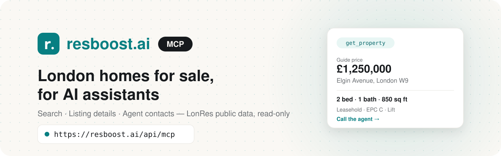

<div align="center">

<picture>
  <source media="(prefers-color-scheme: dark)" srcset="assets/banner-dark.svg">
  <source media="(prefers-color-scheme: light)" srcset="assets/banner-light.svg">
  
</picture>

<br/>

[](#getting-started)
[](#the-tools)
[](#what-it-can-and-cant-see)
[](LICENSE)

</div>

## What is this?

[resboost.ai](https://resboost.ai) lists homes for sale across London, straight from the estate agents marketing them, using LonRes's public listing data.

This MCP server lets AI assistants like Claude and ChatGPT search those listings and read them in full. Answers about prices, sizes, leases and who to call come from the live listing, not from guesswork or an out-of-date portal scrape.

It's hosted, so there's nothing to install or run.

## Getting started

Add this URL to your AI assistant:

```
https://resboost.ai/api/mcp
```

That's it. No account, no API key.

**Claude** (claude.ai or the desktop app): Settings → Connectors → *Add custom connector*, name it resboost.ai, paste the URL.

**ChatGPT:** Settings → Apps & Connectors → *Create*, paste the URL, choose no authentication. Custom connectors may need developer mode, under Advanced settings.

**Claude Code:**

```bash
claude mcp add --transport http resboost https://resboost.ai/api/mcp
```

<details>
<summary><b>Cursor, VS Code, Gemini CLI, Windsurf and everything else</b></summary>

<br/>

Cursor (`~/.cursor/mcp.json`):

```json
{
  "mcpServers": {
    "resboost": { "url": "https://resboost.ai/api/mcp" }
  }
}
```

VS Code / GitHub Copilot (`.vscode/mcp.json`):

```json
{
  "servers": {
    "resboost": { "type": "http", "url": "https://resboost.ai/api/mcp" }
  }
}
```

Gemini CLI (`~/.gemini/settings.json`):

```json
{
  "mcpServers": {
    "resboost": { "httpUrl": "https://resboost.ai/api/mcp" }
  }
}
```

Windsurf (`~/.codeium/windsurf/mcp_config.json`):

```json
{
  "mcpServers": {
    "resboost": { "serverUrl": "https://resboost.ai/api/mcp" }
  }
}
```

Anything else that speaks MCP: use streamable HTTP at the URL above. The registry card lives at
[`/.well-known/mcp/server.json`](https://resboost.ai/.well-known/mcp/server.json), and there's a copy in [`server.json`](server.json).
There's also a [server card](https://resboost.ai/mcp/server-card) and an [AI catalogue](https://resboost.ai/.well-known/ai-catalog.json).

Step-by-step guides for each assistant are on [resboost.ai/mcp](https://resboost.ai/mcp).

</details>

## Things you can ask

- *"Find two-bed flats in W9 or NW8 under £900,000 with outside space."*
- *"What's the cheapest three-bedroom house for sale in NW3 right now?"*
- *"Here's a resboost.ai link. What's the service charge, how long is the lease, and what's the EPC?"*
- *"Who's selling this flat, and what's their number?"*

## The tools

There are two, and they both just read:

| Tool | What it's for |
|---|---|
| `search_properties` | Homes for sale in London, lowest price first: by street, area or postcode district, price, bedrooms, bathrooms, property type, outside space and parking. Up to 50 results; it tells your assistant when to narrow down. |
| `get_property` | Everything public about one listing: price and status, facts (tenure, lease, service charge, ground rent, EPC, floor, lift…), the agent's description, photo and floorplan counts, tour and video links, and the marketing agent's contact details. |

Successful tool responses include readable text and typed structured content (declared in each tool's `outputSchema`) that clients can rely on.

## What it can and can't see

- It only sees what LonRes already publishes for each listing, the same as the listing pages on resboost.ai. No buyer accounts or private buyer records; public marketing contact details may include a negotiator’s name.
- It can't book viewings, make offers, send enquiries or change anything. It gives you the agent's own phone, email or WhatsApp, and you take it from there.
- Search covers homes **for sale**. Rentals can't be searched yet, though a lettings listing can be read by its ID.
- Addresses stop at the street and postcode district: never a flat or house number.
- Sold, let and withdrawn listings keep their facts but lose their price and contact details.
- Please be gentle with it. It's meant for people asking about homes, not for bulk-copying listings, which belong to the agents marketing them.

## The important bit

> [!IMPORTANT]
> resboost.ai is a listings directory, not an estate agent, and nothing here is financial, legal or survey advice.
>
> Descriptions, measurements and facts are supplied by the marketing agent and aren't verified by us. Always confirm the details, including lease terms, service charges and floor areas, with the agent before you rely on them.

The tools label agent-written text as "not verified", so your assistant should pass that on too.

## Found a problem?

If it's a security issue, please [report it privately](https://github.com/ResBoost/MCP/security/advisories/new) rather than opening a public issue. There's more in [SECURITY.md](SECURITY.md).

For anything else (wrong data, a listing that looks off, ideas), issues are very welcome. If a listing's details are wrong, the marketing agent can correct them at source, and they'll update here too.

## Source code

The code behind the public server is in [`src/`](src), so you can see exactly what each tool does and what it returns.

It runs inside the resboost.ai app and uses the app's LonRes client and config, so it won't run on its own from this repo. It's here so it can be read and checked. [`scripts/sync-from-resboost.sh`](scripts/sync-from-resboost.sh) copies it across from the app, and validates a staged copy before replacing the snapshot.

| Where | What |
|---|---|
| [`src/app/api/mcp/route.ts`](src/app/api/mcp/route.ts) | The endpoint: stateless streamable HTTP, host and origin checks, body size cap, no batches |
| [`src/server/mcp/server.ts`](src/server/mcp/server.ts) | Registers both tools with their read-only hints, input and output schemas |
| [`src/server/mcp/discovery.ts`](src/server/mcp/discovery.ts) | The registry `server.json`, server card and AI catalogue |
| [`src/lib/property/filters.ts`](src/lib/property/filters.ts) | The search filters and how they're validated |
| [`src/lib/property/present.ts`](src/lib/property/present.ts), [`format.ts`](src/lib/property/format.ts) | How listings are worded: the same formatters the website uses, so AI answers match the page |
| [`src/lib/mcp/assistants.ts`](src/lib/mcp/assistants.ts) | The per-assistant setup guides shown on resboost.ai/mcp |

## Release checks

This repository is a public source snapshot, not an independently deployable app.
The check harness runs its real MCP SDK transport against a fake listing service;
it never loads private app configuration or calls LonRes.

```bash
npm ci
npm run check
```

The SDK, Zod and test runner versions are pinned in `package.json` and
`package-lock.json`. CI runs these checks on pushes and pull requests.
To check the deployed service, run `npm run check:live`. That makes one public
search and one listing lookup and checks the handshake, tools and registry metadata.
An empty sample search is reported as a failed check requiring manual verification.

See [RELEASING.md](RELEASING.md) for the app deployment and publishing procedure.
Source changes must also be applied to the parent app before deploying; syncing
from an older app will replace this snapshot with that older implementation.

## Brand assets

The [logo and favicon assets](assets/README.md) include light and dark SVG logos,
a square mark, browser favicons and an Apple touch icon.

## Licence

The files in this repo are [MIT](LICENSE). The listing data the server returns isn't: it belongs to the agents marketing each home and is published through LonRes. And the resboost.ai name and logo are ours, so please don't use them as your own.

<br/>

<div align="center">


<sub>Made in London by <a href="https://resboost.ai">resboost.ai</a> · listing data from <a href="https://www.lonres.com">LonRes</a></sub><br/>
<sub><a href="CHANGELOG.md">Changelog</a> · <a href="SECURITY.md">Security</a></sub>

</div>
